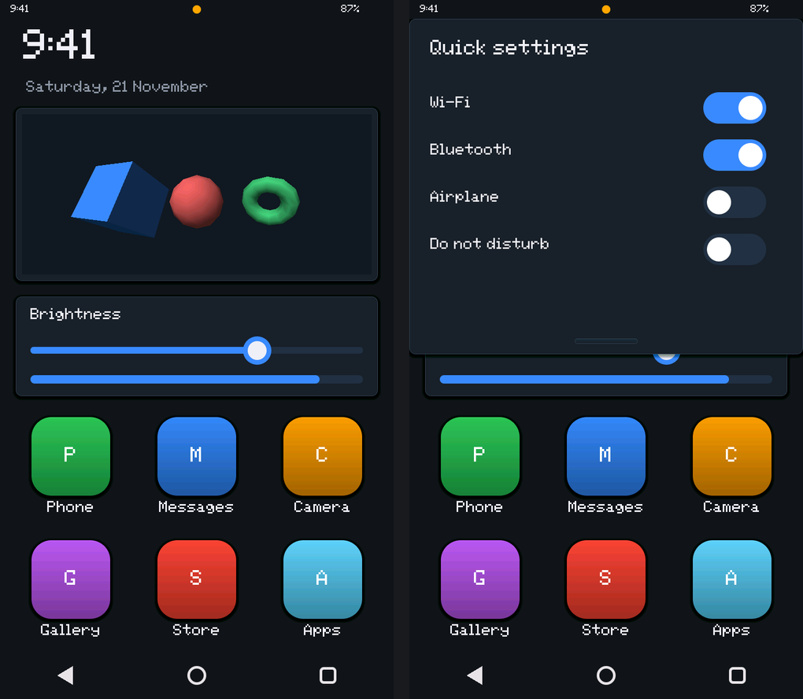
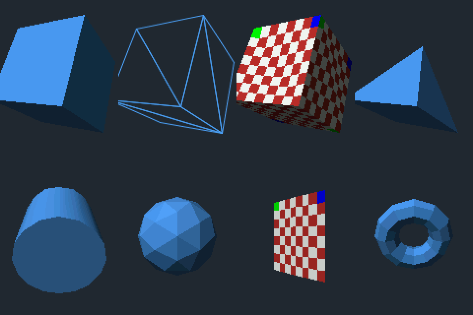

<div align="center">

# 🖼 ECCLES GUI

### 2D widgets and real 3D on a microcontroller. No framebuffer.

**One header · one `.c` · one config header · plain C99 · no heap, no floats, no libm**

[](https://github.com/igwe-starking/eccles-gui/actions/workflows/ci.yml)
[](CHANGELOG.md)
[](LICENSE)
[](#)
[-brightgreen.svg)](#-memory---the-honest-part)

</div>

```c
eccles_gui_init(&gui, &d);                    // your band buffer + your flush() callback
eccles_gui_button_create(&gui, eccles_gui_root(&gui), "Press me");
eccles_gui_update(&gui, my_millis());         // redraws only what changed, a few lines at a time
```

An ultra low RAM UI engine: you provide a small band buffer and a `flush()` function for your display
driver, and it draws anti-aliased 2D widgets and a software 3D scene through them.

---



*The screen above is `make phone`: the full 750 x 1334 Eccles Phone UI, status bar, nav bar, a live 3D card, controls, app grid and an animated swipe-down shade. It is drawn through a **24 KB** band buffer. A framebuffer for that panel would be 2 MB.*

---

## ✨ Why ECCLES GUI

| | |
|---|---|
| 🧩 **Drop-in** | Three files. The object only imports `memcpy` and `memset`. |
| 🪶 **No framebuffer** | A 750 × 1334 panel is driven through a 24 KB band buffer. |
| 🧊 **Real 3D** | Fixed-point software rasteriser with shading, textures, wireframe and optional z buffer. |
| 👆 **Interactive** | Click, long press, drag, swipe, kinetic scrolling and animations. |
| ✂️ **Trimmable** | 3D, widgets, animation, anti-aliasing and shadows can each be compiled out. |
| 🧪 **Seriously tested** | 53,871 checks, 12 configurations, a seeded widget fuzzer under sanitizers. |

---

## 🚀 Quick start

No hardware needed (renders to image files on your PC):

```bash
make examples          # quickstart, demo, meshes, phone  (PNG output needs python3 + pillow)
```

```c
#include "eccles_gui.h"

static uint16_t band[320 * 16];          // 16 lines of a 320 px wide panel = 10 KB
static eccles_gui_t gui;                 // the whole UI lives in here, no malloc

static void flush(void *user, int x, int y, int w, int h, const uint16_t *px) {
    my_panel_write(x, y, w, h, px);      // <- your display driver. rgb565, w*h pixels, row after row
}

static void on_button(eccles_gui_t *g, const eccles_gui_event_t *ev) {
    if (ev->code == ECCLES_GUI_EV_CLICKED) eccles_gui_set_text(g, ev->obj, "Thanks!");
}

void ui_task(void) {
    eccles_gui_desc_t d = {0};
    d.width = 320; d.height = 480;
    d.buf = band; d.buf_pixels = 320 * 16;
    d.flush = flush;
    if (eccles_gui_init(&gui, &d) != ECCLES_GUI_SUCCESSFUL) return;

    eccles_gui_obj_t root  = eccles_gui_root(&gui);
    eccles_gui_obj_t title = eccles_gui_label_create(&gui, root, "Hello");
    eccles_gui_obj_set_style(&gui, title, ECCLES_GUI_STYLE_LABEL_TITLE);
    eccles_gui_obj_set_pos(&gui, title, 10, 10);

    eccles_gui_obj_t btn = eccles_gui_button_create(&gui, root, "Press me");
    eccles_gui_obj_set_pos(&gui, btn, 10, 60);
    eccles_gui_obj_on(&gui, btn, on_button, NULL);

    for (;;) {
        int x, y; bool down;
        my_touch_read(&x, &y, &down);
        eccles_gui_touch(&gui, x, y, down);       // events fire from here
        eccles_gui_update(&gui, my_millis());     // animations + redraw what changed
        my_sleep(16);
    }
}
```

That is the whole integration. More in [Getting started](docs/Getting-Started.md).

Also packaged as a **PlatformIO** library (`library.json`), an **Arduino** library (`library.properties`),
an **ESP-IDF** component (`idf_component.yml`) and a plain **CMake** target (`eccles::gui`).

### A 3D widget in six lines

```c
eccles_gui_obj_t v = eccles_gui_view3d_create(&gui, root);
eccles_gui_obj_set_area(&gui, v, 10, 120, 300, 200);
int cube = eccles_gui_view3d_add(&gui, v, &eccles_gui_mesh_cube, ECCLES_GUI_HEX(0x3D8BFF));
// spin it forever, from the animation pool
eccles_gui_anim_t a = {0};
a.obj = v; a.prop = ECCLES_GUI_ANIM_V3D_YAW; a.index = (uint8_t)cube;
a.from = 0; a.to = 65536; a.duration_ms = 4000; a.repeat = ECCLES_GUI_ANIM_REPEAT_FOREVER;
eccles_gui_anim_start(&gui, &a);
```

---

## 🧭 How it works: it never holds a frame

Almost every embedded UI library needs either a full framebuffer or a big partial buffer plus a lot of retained state. Eccles GUI keeps only:

1. a **tree of widgets** (40 bytes each),
2. a short list of **dirty rectangles**,
3. **one small band buffer that you provide**, as many lines as you can spare.

`eccles_gui_update()` takes the dirty rectangles, and for each one draws the widget tree into the band buffer a few lines at a time. Every finished band goes to **your** `flush()` callback (your SPI / QSPI / RGB / DMA driver). Nothing else is ever stored: not the previous frame, not the current one.

```
widget tree ──► dirty rectangles ──► band buffer (16 lines) ──► your flush() ──► panel
   ~2 KB            64 bytes              24 KB for 750 px            DMA
```

The same machinery draws the 3D scene: the model is projected **once per frame**, and each band just rasterises the triangles that touch it.

---

## 📚 The API

| | |
|---|---|
| **Setup & loop** | `eccles_gui_init` · `eccles_gui_touch` · `eccles_gui_update` · `eccles_gui_render_area` |
| **Widgets** | `eccles_gui_<panel, label, button, ...>_create` · `eccles_gui_obj_set_*` · `eccles_gui_obj_on` |
| **Animation** | `eccles_gui_anim_start` |
| **3D** | `eccles_gui_view3d_*` · `eccles_gui_draw_view3d` |
| **Errors** | `eccles_gui_last_error` · `eccles_gui_last_error_str` |

The full reference, generated from the header, is in [`docs/API.md`](docs/API.md). Guides:
[Getting started](docs/Getting-Started.md) · [Widgets and styles](docs/Widgets-and-Styles.md) · [3D](docs/3D.md) ·
[Assets](docs/Assets.md) · [Memory sizing](docs/Memory-Sizing.md) · [Architecture](docs/Architecture.md) ·
[Porting](docs/Porting.md)

---

## ✅ What it draws

**2D** - anti aliased rounded rectangles, discs, rings, arcs with round caps and thick lines (all without a square root), gradients, soft shadows, bevels, filled triangles, UTF-8 text (a built in 5x8 font at any scale, plus 1/4/8 bit fonts of your own), images (RGB565, color key, A8 / A4 / A1 icons tinted at draw time).

**Widgets** - panel, label, button, image, slider, switch, checkbox, progress bar, arc gauge, scrolling list with kinetic scroll, custom (your draw callback), and **view3d**. Styles + a dark/light theme, alignment, row/column layout, per widget opacity.

**Input** - one finger: click, long press, drag, swipe gestures that bubble up the tree, slider drag, list scroll and fling.

**Animation** - tweens on position, size, opacity, value, 3D rotation, or any integer through a callback; 7 easing curves, delay, repeat, yoyo.

**3D** - a fixed point software rasteriser: flat, smooth (Gouraud), textured, unlit and wireframe, back face culling, painter's algorithm or an optional per-band z buffer. Six built in meshes and an `.obj` converter. It is a widget (`view3d`), or you call `eccles_gui_draw_view3d()` anywhere inside your own draw callback.



## ⚙️ Configuration

`config/eccles_gui_config.h` (picked up with `__has_include`, or pass `-D`). Every pool is a fixed array inside the context, and every feature can be removed:

```
ECCLES_GUI_NO_3D  ECCLES_GUI_NO_WIDGETS  ECCLES_GUI_NO_ANIM  ECCLES_GUI_NO_AA  ECCLES_GUI_NO_SHADOW
ECCLES_GUI_NO_BUILTIN_FONT  ECCLES_GUI_NO_BUILTIN_MESHES
ECCLES_GUI_MAX_WIDGETS / _STYLES / _FONTS / _DIRTY / _ANIMS / _VIEWS3D
ECCLES_GUI_3D_MAX_OBJECTS / _MAX_VERTS / _MAX_FACES / _ZBUFFER / _TEXTURES
ECCLES_GUI_SWAP_BYTES   ECCLES_GUI_EXEC_IRAM   ECCLES_GUI_TOUCH_SLOP / _SWIPE_MIN / _LONG_PRESS_MS
```

With `ECCLES_GUI_NO_WIDGETS` the engine is just the band renderer plus the drawing functions: you call `eccles_gui_render_area()` with your own draw callback (immediate mode).

## 🔌 Where it runs

You write **one function** (`flush`) and optionally a wait function for DMA. The engine has no HAL, no time source (you pass milliseconds to `eccles_gui_update`), no touch driver. [Porting](docs/Porting.md) has the SPI/DMA double buffering recipe, byte swapping, IRAM and threading.

### Eccles Phone

`examples/eccles_phone/` is a drop-in port for `panel_hal` plus a complete system UI. One finding that matters: `panel_hal_blit()` is clipped to the app area on purpose, so the system UI needs a **raw** full-panel blit (`panel_hal_blit_raw`). The example declares it and ships a stub. See [Eccles Phone integration](docs/Eccles-Phone.md).

---

## 🧠 Memory - the honest part

| | |
|---|---|
| Engine state (`sizeof(eccles_gui_t)`, defaults) | **6,796 bytes** with 32-bit pointers (7,880 on a 64-bit host) |
| One widget | 40 bytes (32-bit) |
| Band buffer | yours to choose: `width x lines x 2`. 750 x 16 = 24,000 bytes |
| Code, full engine (x86-64, `-Os`) | 56 KB, of which 8.7 KB is the built in font, sine table and six meshes |
| Code, no 3D / no 3D+anim+shadow+AA / renderer only | 40 KB / 38 KB / 33 KB |
| Stack (x86-64) | worst frame 800 B (3D draw), about 320 B per level of widget nesting: give the UI task 4 KB |
| Heap / floats / libm | none / none / none (the object file only imports `memcpy` and `memset`) |

Code sizes are for x86-64 because that is the compiler I could run; Thumb-2 and Xtensa builds are normally smaller, but **measure on your toolchain** (`make size` shows how). Context sizes were measured by compiling the struct layouts for 32-bit pointers (see [Memory sizing](docs/Memory-Sizing.md)).

## ⚠️ Limitations (read before you design around them)

- **Verified on a host (x86-64, GCC) under sanitizers. Not run on a physical ESP32, STM32 or RP2040 by the author of this release**: the platform paths (`ECCLES_GUI_EXEC_IRAM`) are compile checked with mocks only. Frame times in `make bench` are x86 numbers and say nothing about your MCU; measure on the device.
- Single threaded: call everything from one task, or guard it with your own mutex.
- Children are clipped to their parent's **rectangle**, not its rounded shape. Opacity of a widget multiplies into its children but is not true group opacity (overlapping children show through each other).
- Text: left to right, no kerning, no shaping, no wrapping hyphenation; the built in font is ASCII + `° × •`, use `ttf2eccles_font.py` for more.
- 3D: faces that cross the near plane are dropped, not clipped; texture mapping is affine (subdivide big faces, the built in `card` is 4x4 for this reason); arc edges at the angular cut are not anti aliased (use round caps); fonts, images and meshes are **trusted** data (see SECURITY.md).
- No text input widget or on-screen keyboard yet.
- Two `view3d` widgets that share bands re-project their scene for every band (the per-frame cache holds one scene). Keep 3D views apart or use one.

## 🔬 How it was tested

`make test-asan` runs 53,871 checks under AddressSanitizer and UBSan. The ones that matter most are **invariants**, not examples:

- **The picture never depends on the band height.** A full scene (every widget, a 3D view with textures and smooth shading) is rendered at band heights 1, 2, 3, 5, 7, 13, 16, 40 and full, with and without a z buffer, and must be bit identical.
- **An incremental update equals a full redraw.** After every kind of mutation the dirty-rect result must match what `invalidate_all()` produces.
- **Async flush owns its buffer.** A simulated DMA checks that the engine never touches a buffer that is still being sent, with one buffer and two.
- Geometry is measured, not eyeballed: a radius 40 disc covers 5,022 pixels (ideal 5,027), shared triangle edges leave no cracks and no double drawn pixels, the sine table is within 1.5/32767.
- A seeded **fuzzer** creates, deletes, moves, restyles, re-parents, touches and animates widgets with random band heights and compares incremental vs full after every few steps (66,000 steps in `make fuzz`).
- The whole suite passes in **12 configurations** (`make test-all`): no 3D, no anim, no AA, no shadow, no widgets, swapped bytes, no z buffer, tiny pools, big pools, lean.

The fuzzer found a real bug during development: giving the root widget a rounded style left its corner pixels showing whatever the previous band had drawn. The root is now forced to cover every pixel.

---

## 🧰 Tools

| | |
|---|---|
| `tools/png2eccles.py` | PNG to C image: RGB565, color key, A8, A4, A1 |
| `tools/ttf2eccles_font.py` | TTF/OTF to an anti aliased font (1/4/8 bit, any ranges) |
| `tools/obj2mesh.py` | Wavefront `.obj` to a mesh with normals, uv, smooth or flat |
| `tools/gen_data.py` | regenerates the built in font, sine table and meshes inside `eccles_gui.c` (`--check` in CI) |

## 🗂 Repository layout

```
src/eccles_gui.h        the public API
src/eccles_gui.c        the engine
config/eccles_gui_config.h
examples/host/          demo, meshes gallery, benchmark (run on your pc, write .ppm)
examples/eccles_phone/  panel_hal port + a full phone UI + host simulator
tools/                  asset converters and generators
tests/                  the suite, platform mocks, C++ check, tools test
docs/                   guides + generated API reference
```

## 🛠 Development

```bash
make test-asan     # lint + the whole suite under ASan + UBSan
make test-all      # 12 configurations
make fuzz          # widget fuzzer
make size          # code size
```

Contributions are welcome: see [CONTRIBUTING.md](CONTRIBUTING.md). Found a security issue? See
[SECURITY.md](SECURITY.md).

## 🧩 The EcclesRTLib family

| Library | What it gives your firmware |
|---|---|
| [`eccles-wasm`](https://github.com/igwe-starking/eccles-wasm) | Sandboxed WebAssembly |
| [`eccles-web`](https://github.com/igwe-starking/eccles-web) | HTML, CSS and JavaScript pages |
| **`eccles-gui`** (this one) | 2D widgets and 3D without a framebuffer |
| [`eccles-media`](https://github.com/igwe-starking/eccles-media) | Images, audio and video |
| [`eccles-rtmem`](https://github.com/igwe-starking/eccles-rtmem) | The rest of your firmware's allocations |

## 📄 License

[MIT](LICENSE) © Nwobodo Ecclesiastes
